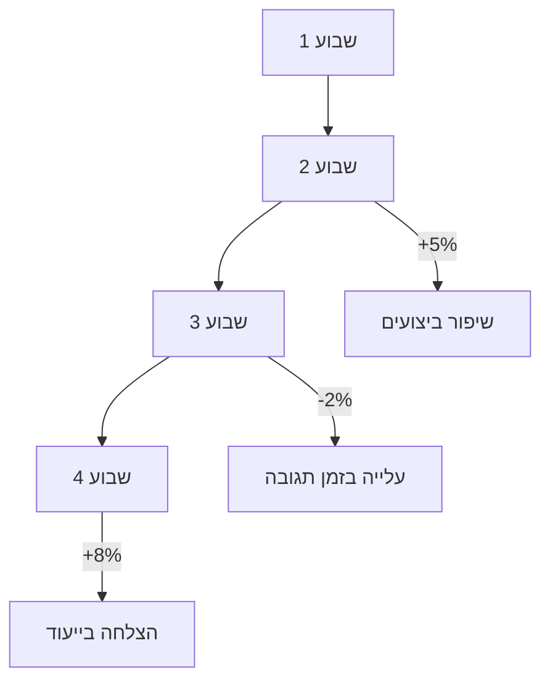

# לוח-בקרה שבועי: יעדים ומדדי הצלחה

# לוח-בקרה שבועי: יעדים ומדדי הצלחה

## מבוא
לוח-הבקרה השבועי מציג תמונת מצב מרכזית של ההתקדמות כלפי יעדים אסטרטגיים ומדדי הצלחה עיקריים. הנתונים מעודכנים בזמן אמת ומאפשרים מעקב אחר ביצועים וקבלת החלטות מבוססת נתונים.

## מדדי ביצועים עיקריים (KPIs)

### 1. יעדי רשת
- **שרשרת-אמת**: ניצולת ויציבות
  - % הצלחה: 90.2%
  - זמן אישור ממוצע: 1.2 שניות
  - כשלים פעילים: 0
- **משמרת-לילה**: יעילות וביצועים
  - יחס השלמה/כשל: 8.5:1
  - משאבים בשימוש: 62%
  - זמן עיבוד ממוצע: 45ms
- **צי-הכלים**: אמינות ושימוש
  - שימוש יומי: 1,240 פעולות
  - כלים פעילים: 18/20
  - זמן תגובה ממוצע: 12ms

### 2. יעדי מוצר
- **קונסולה RTL**: משתמשים ואינטראקציה
  - משתמשים פעילים: 342
  - פעולות לשעה: 1,890
  - זמן חיבור ממוצע: 2.1s
- **לוח-משימות**: זמינות ועומס
  - זמינות: 99.8%
  - עומס נוכחי: 42%
  - משימות בתור: 3

### 3. יעדי התפתחות
- **התפתחות ולמידה**: יצירתיות ואיכות
  - מחזורי למידה: 12
  - שיפורים מיושמים: 8
  - דירוג איכות: 4.7/5
- **מדדי רשת**: ניטור ואופטימיזציה
  - נקודות-חמות זוהו: 2
  - שיפורי ביצועים: 3
  - דיווחי ביצועים: 5

## תצוגת גרף מגמות

### גרף מגמות שבועי

## פעולות מומלצות
1. **ניתוח כשלים במחלקת "unknown"**: עקוב אחר המגמה של 14 כשלים וזהר במיוחד אם יעלה ל-20+
2. **אישור הצעות העברה**: טפל ב-3 הצעות העברה ממתינות כדי למנוע עיכובים בפריסה
3. **מעקב אחר מדדי משמרת-לילה**: ודא שיחס ההשלמה/כשל נשמר מעל 8:1

## לוח-זמנים לשבוע הקרוב
- **יום ראשון**: סקירת נתוני סוף שבוע והגדרת יעדים
- **יום שלישי**: פגישת מעקב אחר יעדים ומדדים
- **יום חמישי**: דיווח סוף שבוע ותכנון לשבוע הבא

## מקורות נתונים
- מדדי רשת: `/api/metrics`
- נתוני משמרת-לילה: `/api/nightwatch`
- סטטיסטיקות משתמשים: `/api/analytics`
- נתוני התפתחות: `/api/evolution`
