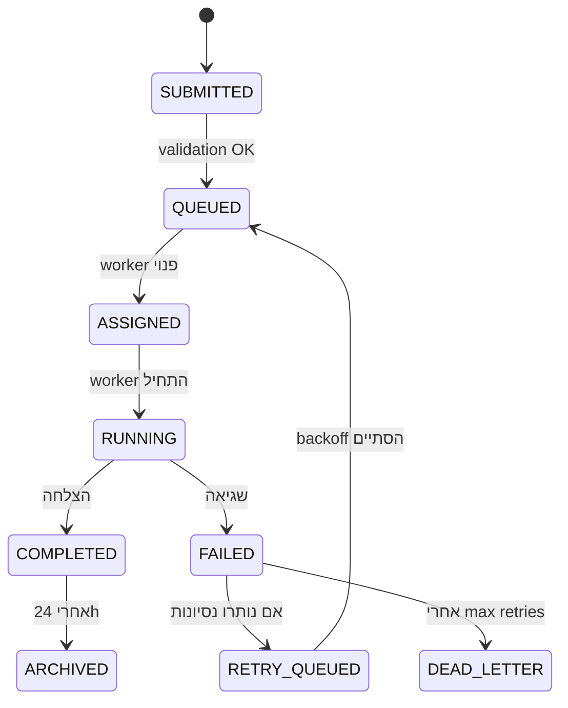

# מדריך תפעול: לוח-המשימות (Dispatch → Workers) — ניהול תורים, הקצאה ומעקב בזמן אמת

# מדריך תפעול: לוח-המשימות (Dispatch → Workers)

> **קהל יעד**: מפעילי רשת-ביצוע, מנהלי תורים, אוטומציות CI/CD
> **משטח**: לוח-המשימות — הממשק המרכזי להקצאת עבודה לצי ה-Workers

---

## 1. ארכיטקטורה בקצרה

```
Dispatch (API/CLI/UI) → Task Queue (Redis Streams) → Workers Pool → Result Aggregator → Ledger
```

| רכיב | תפקיד | טכנולוגיה |
|-------|--------|-----------|
| **Dispatcher** | מקבל בקשות, מתקף, יוצר רשומות משימה | Fastify + Zod validation |
| **Queue** | תור עדיפויות עם TTL, retry-backoff, dead-letter | Redis Streams + consumer groups |
| **Workers** | מבצעים בפועל (build, test, deploy, audit) | Node.js isolates, Docker, WASM |
| **Aggregator** | אוסף תוצאות, מעדכן סטטוס, כותב ל-Ledger | Event-sourced projection |
| **Ledger** | שרשרת-אמת בלתי-ניתנת לשינוי | Hash-chain (SHA-256, Merkle roots) |

---

## 2. מחזור חיים של משימה



### שדות חובה ביצירה (`POST /api/tasks`)
```json
{
  "kind": "build|test|deploy|audit|custom",
  "payload": { /* תלוי-סוג, ראה סעיף 3 */ },
  "priority": 0-9 (ברירת מחדל 5),
  "maxRetries": 3,
  "timeoutMs": 300000,
  "tags": ["release:v1.2", "team:frontend"]
}
```

---

## 3. סוגי משימות ותבניות Payload

### 3.1 Build
```json
{
  "repo": "saos-dex/fabric",
  "ref": "main",
  "artifact": "lodash-saos-dex",
  "env": {"NODE_ENV": "production"}
}
```

### 3.2 Test
```json
{
  "suite": "unit|integration|e2e",
  "filter": "**/*.spec.ts",
  "coverageThreshold": 80
}
```

### 3.3 Deploy
```json
{
  "target": "staging|production",
  "service": "api-gateway",
  "version": "v1.2.3",
  "rollbackOnFailure": true
}
```

### 3.4 Audit (שרשרת-אמת)
```json
{
  "scope": "chain-integrity|metrics-consistency|handoff-verification",
  "depth": "full|incremental"
}
```

---

## 4. תפעול יומיומי — צ'ק-ליסט בוקר

| פעולה | פקודה / UI | סף התראה |
|--------|-------------|-----------|
| בדיקת תור ממתין | `GET /api/tasks?status=QUEUED` | > 50 משימות |
| עובדים תקועים | `GET /api/workers?status=STALLED` | > 0 |
| כשלים 24h אחרונים | `GET /api/tasks?status=FAILED&since=24h` | > 5% מכלל |
| Dead-letter queue | `GET /api/tasks?status=DEAD_LETTER` | > 0 |
| בריאות Ledger | `GET /api/chain/health` | `ok: true` |

**פעולה מומלצת**: אם תור > 50 — הגדל Workers pool או הורד עדיפות למשימות לא-דחופות.

---

## 5. ניטור ויזואלי בלוח

### עמודות עיקריות
| עמודה | משמעות | צבע מצב |
|--------|---------|-----------|
| **ID** | מזהה ייחודי (ULID) | — |
| **Kind** | סוג משימה | 🔵 build 🟢 test 🟠 deploy 🔴 audit |
| **Status** | מצב נוכחי | 🟡 QUEUED 🔵 ASSIGNED 🟢 RUNNING ✅ COMPLETED ❌ FAILED ⚫ DEAD_LETTER |
| **Worker** | מזהה עובד מבצע | `worker-7` |
| **Progress** | אחוז התקדמות (אם נתמך) | 0-100% |
| **Elapsed** | זמן ריצה נוכחי | `2m 34s` |
| **Retry** | ניסיון נוכחי / מקסימום | `2/3` |
| **Tags** | תגיות סינון | `release:v1.2`, `team:frontend` |

### פילטרים שימושיים
- `status:FAILED retry:<3` — משימות שניתן עדיין לשחזר
- `worker:worker-3` — כל המשימות של עובד ספציפי
- `tag:release:v1.2` — מעקב אחר גרסה
- `age:>1h status:QUEUED` — תקועים בתור

---

## 6. טיפול בחריגים (Runbooks)

### 6.1 Worker נתקע (STALLED)
```bash
# 1. זיהוי
curl /api/workers?status=STALLED

# 2. סימון משימה כ-FILED להחזרה לתור
curl -X POST /api/tasks/{id}/requeue -H "Authorization: Bearer $TOKEN"

# 3. הפעלה מחדש של העובד
curl -X POST /api/workers/{workerId}/restart
```

### 6.2 כשל חוזר (FAILED, retry exhausted)
1. פתח פרטי משימה → ראה `error.stack`
2. אם שגיאת תשתית (network, OOM) → `POST /api/tasks/{id}/retry`
3. אם שגיאת קוד → צור Issue, סמן `DEAD_LETTER` ידנית
4. עדכן `maxRetries` לסוג המשימה אם נדרש

### 6.3 Dead Letter Queue צומח
```bash
# ייצוא לניתוח
curl /api/tasks?status=DEAD_LETTER&format=json > dead-letter-$(date +%F).json

# ניקוי אחרי תיקון שורש
curl -X DELETE /api/tasks/dead-letter?olderThan=7d
```

---

## 7. אופטימיזציית תפוקה

| מדד | יעד | פעולה אם חורג |
|------|------|-----------------|
| **Throughput** (tasks/min) | > 120 | Scale workers horizontally |
| **P95 Latency** (queue→complete) | < 45s | Check worker saturation |
| **Failure Rate** | < 2% | Investigate error patterns |
| **Retry Rate** | < 10% | Fix flaky tests / infra |
| **Queue Depth** | < 30 | Auto-scale dispatcher |

### הגדרת Auto-scaling (דוגמה)
```yaml
# worker-autoscaler.config.yaml
metrics:
  - name: queue_depth
    source: redis:stream:tasks:pending
    scaleUp:  > 40 for 2m
    scaleDown: < 10 for 10m
  - name: worker_utilization
    source: prometheus:worker_cpu_percent
    scaleUp:  > 80%
    scaleDown: < 30%
limits:
  minWorkers: 3
  maxWorkers: 50
```

---

## 8. אינטגרציה עם שרשרת-אמת (Ledger)

כל משימה שהושלמה (`COMPLETED`/`FAILED`) נרשמת ב-Ledger:
```bash
# אימות שלמות למשימה ספציפית
curl /api/chain/verify/{taskId}

# ייצוא הוכחת-ביצוע לגורם חיצוני
curl /api/chain/proof/{taskId} > proof-{taskId}.json
```

**שדות בהוכחה**: `taskId`, `status`, `workerId`, `startedAt`, `finishedAt`, `resultHash`, `merkleRoot`, `chainIndex`.

---

## 9. API מהיר — פקודות נפוצות

```bash
# יצירת משימה
curl -X POST /api/tasks \
  -H "Content-Type: application/json" \
  -H "Authorization: Bearer $TOKEN" \
  -d '{"kind":"build","payload":{"repo":"saos-dex/fabric","ref":"main"},"priority":7}'

# סטטוס משימה
curl /api/tasks/{id}

# ביטול משימה בתור
curl -X POST /api/tasks/{id}/cancel

# חזרה לתור (requeue)
curl -X POST /api/tasks/{id}/requeue

# רשימת עובדים
curl /api/workers

# מדדי תור
curl /api/metrics/queue
```

---

## 10. שאלות נפוצות (FAQ)

**ש: משימה תקועה ב-QUEUED שעות — למה?**
ת: בדוק `GET /api/workers` — ייתכן שאין עובדים פנויים לסוג המשימה (`kind`). הרחב pool או שנה עדיפות.

**ש: איך משנים עדיפות למשימה קיימת?**
ת: `PATCH /api/tasks/{id} {"priority": 9}` — עובד רק אם עדיין `QUEUED`.

**ש: האם ניתן לתזמן משימה לעתיד?**
ת: כן — הוסף שדה `runAt: "2026-10-22T03:00:00Z"` ביצירה.

**ש: איך מקשרים משימה ל-Deployment ספציפי?**
ת: השתמש ב-`tags: ["deployment:dep-abc123"]` וסנן בלוח.

---

## 11. קישורים שימושיים

- **API Spec**: `/api/docs#/tasks` (OpenAPI 3.1)
- **Metrics Dashboard**: `/metrics/tasks` (Grafana)
- **Chain Explorer**: `/chain/explorer`
- **Worker Logs**: `kubectl logs -l app=worker -f`
- **Runbook Repository**: `git@github.com:saos-dex/runbooks.git`

---

> **עדכון אחרון**: 2026-10-21 | **גרסה**: 1.0 | **בעלים**: צוות תפעול רשת-ביצוע
> **משוב**: פתח Issue ב-`saos-dex/runbooks` עם התגית `dispatch-board`
