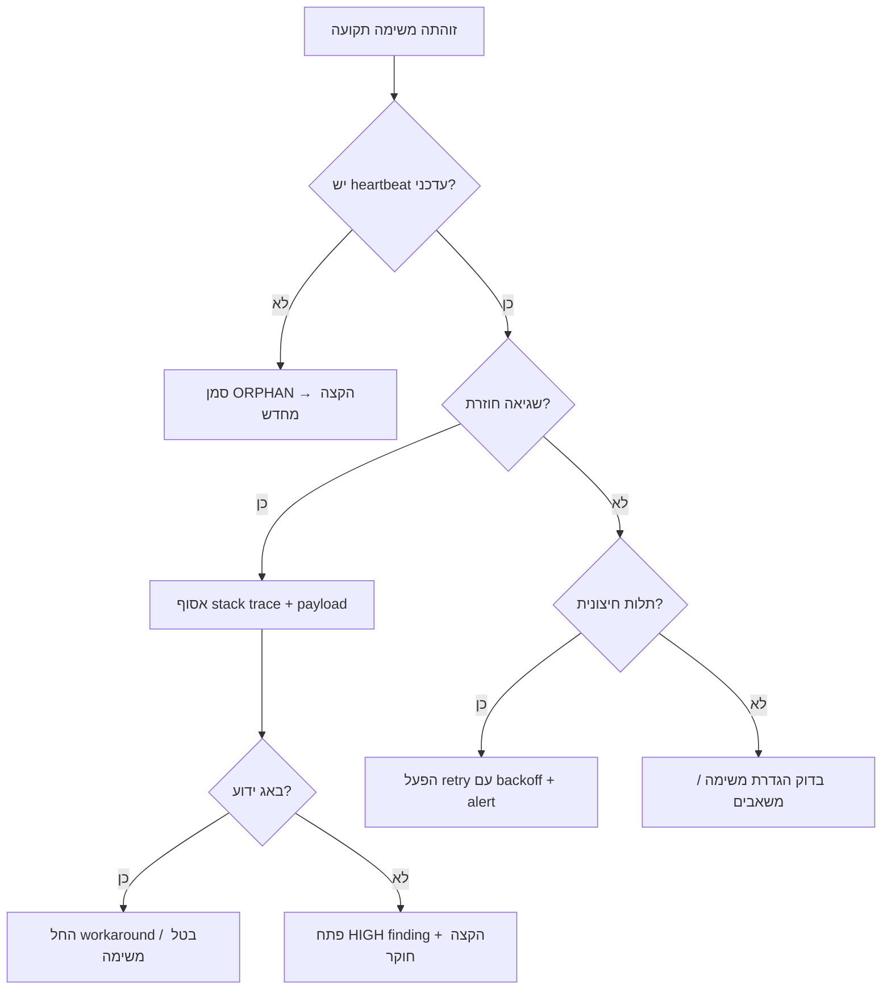

# שאלות-ותשובות: ניהול משימות תקועות וסגירת לולאות פתוחות ברשת-הביצוע

# שאלות-ותשובות: ניהול משימות תקועות וסגירת לולאות פתוחות

> **מטרה**: לאפשר לכל מפעיל/סוכן לזהות במהירות משימה שאינה מתקדמת, להבין את סיבת השורש, ולהפעיל את הנוהל המתאים — בלי להמתין לביקורת חיצונית.

---

## 1. איך מזהים משימה "תקועה" בזמן אמת?

| סימן | מה בודקים | כלי/פקודה |
|------|------------|------------|
| **זמן חריג בסטטוס זהה** | משימה ב-`IN_PROGRESS` > 45 דק' בלי עדכון `heartbeat` | `GET /api/tasks?status=IN_PROGRESS&stale=45m` |
| **ללא הקצאת עובד** | משימה ב-`DISPATCHED` > 10 דק' בלי `workerId` | לוח-משימות → מסנן "ללא עובד" |
| **רצף כישלונות** | אותו `taskId` מופיע 3+ פעמים ב-`FAILED` ב-60 דק' | `GET /api/chain?taskId=X&limit=10` |
| **לולאה פתוחה** | `openLoops` במטא-דאטה > 0 לאותו הקשר | `GET /api/evolution?openLoops=true` |

**כלל אצבע**: אם שניים מהסימנים מתקיימים — הפעל נוהל "משימה תקועה" מיידית.

---

## 2. מהן הסיבות השכיחות לתקיעה?

| קטגוריה | תסמין אופייני | פעולת אבחון מהירה |
|----------|----------------|---------------------|
| **תלות חיצונית** | הלוג מראה `await external:` ואין תשובה > 30 שנ' | בדוק סטטוס השירות החיצוני / `curl` ידני |
| **משאבים חסרים** | שגיאת `ENOMEM` / `CPU throttle` / `disk full` | `GET /api/metrics?resource=worker:<id>` |
| **הגדרת משימה עמומה** | ה-`payload` חסר שדות חובה / סתירה פנימית | השווה מול סכימת המשימה ב-`/api/arsenal/schemas` |
| **באג בקוד העובד** | אותו stack trace חוזר בגרסאות שונות | בדוק `git log --oneline -20` בנתיב העובד |
| **עומס יתר מערכתי** | `queueDepth` > 200 ב-`/api/metrics` | הפעל `scale-up` או `backpressure` |

---

## 3. נוהל טיפול מדורג (Decision Tree)



### פעולות קונקרטיות לכל עלה:

- **ORPHAN**: `POST /api/tasks/{id}/reassign` עם `reason: "stale_heartbeat"`
- **Workaround**: עדכן `payload` עם `bypass: true` אם קיים, אחרת `POST /api/tasks/{id}/cancel` + צור משימה מתוקנת
- **HIGH finding**: `POST /api/evolution/findings` עם `severity: "HIGH", kind: "execution", context: {taskId, pattern}`
- **Retry חיצוני**: `PATCH /api/tasks/{id} {retryPolicy: {max:3, backoffSec: [30,120,300]}}`

---

## 4. תבניות תגובה מוכנות (Copy-Paste)

### א. דיווח על משימה יתומה
```json
{
  "action": "reassign",
  "taskId": "T-20261025-1432",
  "reason": "stale_heartbeat",
  "lastHeartbeat": "2026-10-25T17:05:00Z",
  "newPriority": "high"
}
```

### ב. פתיחת HIGH finding על תבנית כשל חוזרת
```json
{
  "severity": "HIGH",
  "kind": "execution",
  "title": "תבנית כשל: timeout בחיבור ל-DB במשימות batch-export",
  "detail": "נצפה ב-3 משימות שונות ב-30 דק' אחרונות. stack trace זהה.",
  "context": {
    "taskIds": ["T-20261025-1432", "T-20261025-1445", "T-20261025-1451"],
    "worker": "batch-export-v3",
    "error": "ETIMEDOUT after 30000ms"
  }
}
```

### ג. בקשת scale-up דחופה
```json
{
  "action": "scale_request",
  "target": "worker-pool:batch",
  "currentDepth": 247,
  "requestedWorkers": 8,
  "justification": "queueDepth > 200 for 15min, SLA breach risk"
}
```

---

## 5. מדדי מעקב ובקרה (לדשבורד יומי)

| מדד | יעד | מקור |
|-----|-----|------|
| **זמן חציוני לזיהוי משימה תקועה** | < 15 דק' | `chain` timestamps |
| **אחוז משימות שנסגרות בנוהל תקיעה** | < 5% מכלל המשימות | `tasksByStatus` |
| **זמן ממוצע מסימון ORPHAN עד הקצאה מחדש** | < 5 דק' | `chain` events |
| **לולאות פתוחות שנסגרו השבוע** | 100% של פתוחות בתחילת שבוע | `/api/evolution?openLoops` |

---

## 6. טעויות נפוצות — ומה לעשות במקום

| טעות | למה זה מזיק | חלופה נכונה |
|-------|--------------|---------------|
| **"אחכה עוד קצת, אולי יסתדר"** | מגדיל blast radius, מעכב תלויות | הפעל נוהל אחרי 2 סימנים (סעיף 1) |
| **ביטול משימה בלי תיעוד סיבת שורש** | מונע למידה, חוזר על עצמו | תמיד פתח finding / עדכן chain עם `rootCause` |
| **הקצאה מחדש לאותו עובד שנכשל** | חוזר על אותו כשל | שנה `workerId` או `workerVersion` בהקצאה |
| **התעלמות מ-`openLoops` במטא-דאטה** | מצטבר חוב למידה סמוי | סרוק `GET /api/evolution?openLoops=true` בתחילת משמרת |
| **שינוי `retryPolicy` בלי להבין את הסיבה** | מסווה בעיה אמיתית | שנה רק אחרי ניתוח stack trace + אישור חוקר |

---

## 7. צ'ק-ליסט פתיחת משמרת (5 דקות)

1. [ ] `GET /api/tasks?status=IN_PROGRESS&stale=30m` — אין משימות רפאים
2. [ ] `GET /api/evolution?openLoops=true` — רשימת לולאות פתוחות מודפסת
3. [ ] `GET /api/metrics?resource=queueDepth` — מתחת ל-150
4. [ ] עבר על 3 ה-HIGH findings האחרונים — סטטוס טיפול ידוע
5. [ ] ודא ש-`scale-up` policy פעיל ומותאם לעומס צפוי

---

## 8. קישורים מהירים

- **לוח משימות חי**: `/dispatch` (קונסולה RTL)
- **שרשרת-אמת לסינון לפי taskId**: `/chain?taskId=`
- **מדדי עובדים**: `/api/metrics?resource=worker:`
- **פתיחת finding**: `POST /api/evolution/findings`
- **סכימות משימות**: `/api/arsenal/schemas`

---

> **עקרון מנחה**: כל משימה תקועה היא הזדמנות ללמידה מערכתית. תיעוד מסודר + נוהל ברור = פחות תקיעות בעתיד, יותר אמון ברשת.
